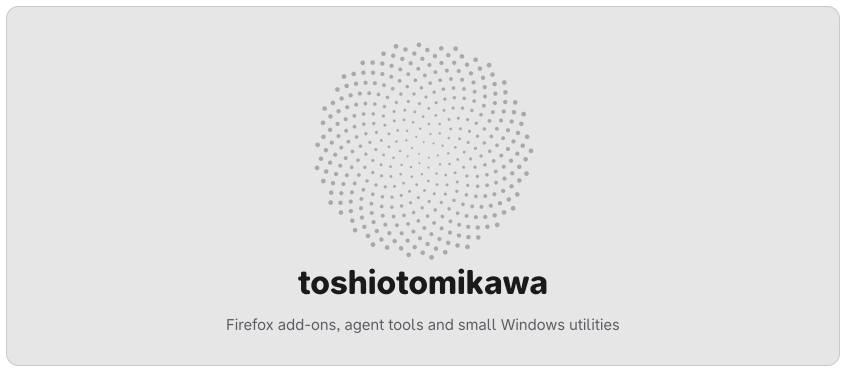
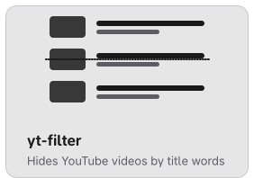
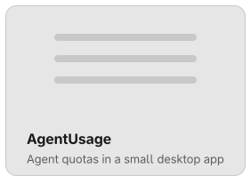
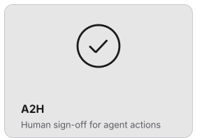
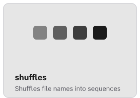

<picture><source media="(prefers-color-scheme: dark)" srcset="assets/hero-dark.svg"></picture>

<a href="https://toshiotomikawa.github.io/">Portfolio</a> &nbsp;·&nbsp; <a href="https://tomiesl.com.br/">Tomi ESL</a>

<a href="https://github.com/toshiotomikawa/firefonts"><picture><source media="(prefers-color-scheme: dark)" srcset="assets/tile-firefonts-dark.svg"></picture></a><a href="https://github.com/toshiotomikawa/yt-filter"><picture><source media="(prefers-color-scheme: dark)" srcset="assets/tile-yt-filter-dark.svg"></picture></a><a href="https://github.com/toshiotomikawa/AgentNodes"><picture><source media="(prefers-color-scheme: dark)" srcset="assets/tile-AgentNodes-dark.svg"></picture></a><a href="https://github.com/toshiotomikawa/a2a-bridge"><picture><source media="(prefers-color-scheme: dark)" srcset="assets/tile-a2a-bridge-dark.svg"></picture></a><a href="https://github.com/toshiotomikawa/AgentUsage"><picture><source media="(prefers-color-scheme: dark)" srcset="assets/tile-AgentUsage-dark.svg"></picture></a><a href="https://github.com/toshiotomikawa/A2H"><picture><source media="(prefers-color-scheme: dark)" srcset="assets/tile-A2H-dark.svg"></picture></a><a href="https://github.com/toshiotomikawa/shuffles"><picture><source media="(prefers-color-scheme: dark)" srcset="assets/tile-shuffles-dark.svg"></picture></a><a href="https://github.com/toshiotomikawa/DeletesDupes"><picture><source media="(prefers-color-scheme: dark)" srcset="assets/tile-DeletesDupes-dark.svg"></picture></a><a href="https://github.com/toshiotomikawa/copy-as-path"><picture><source media="(prefers-color-scheme: dark)" srcset="assets/tile-copy-as-path-dark.svg"></picture></a>

